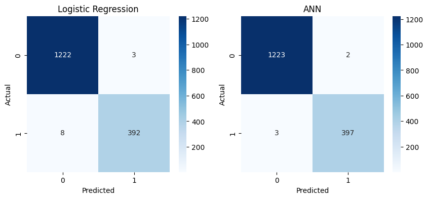
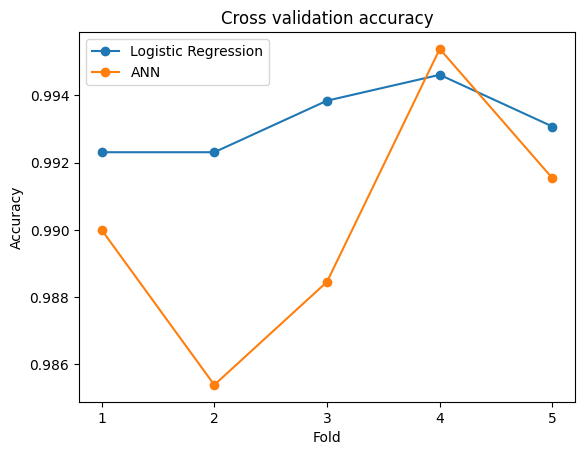

# Red or White Wine Classifier

[](https://colab.research.google.com/github/mikaeilbarout/Wine_type_classifier/blob/main/red_or_white_wine_quality_project.ipynb)

A small machine learning project that predicts whether a wine is **red or white** from its chemical properties.
I built it with **Logistic Regression (scikit-learn)** first, then with a **neural network (TensorFlow / Keras)**, and compared the two.

## Dataset

[Wine Quality dataset](https://archive.ics.uci.edu/dataset/186/wine+quality) from the UCI Machine Learning Repository (Cortez et al., 2009).

| File | Rows | Label |
|---|---|---|
| `winequality-red.csv` | 1,599 | red (`color_red = 1`) |
| `winequality-white.csv` | 4,898 | white (`color_red = 0`) |

Each row has 11 chemical features (acidity, sugar, chlorides, sulfur dioxide, density, pH, sulphates, alcohol, ...) plus a `quality` score.
The CSV files use `;` as the separator.

## What the notebook does

1. Loads both files and adds a `color_red` column
2. Explores the data (pairplots, correlation heatmap, quality counts)
3. Joins red and white wines into one dataset
4. Splits into train/test (75/25, stratified) and scales the features with `StandardScaler`
5. Trains a **Logistic Regression** model
6. Trains an **ANN**: `Dense(32, relu) → Dropout(0.3) → Dense(16, relu) → Dense(1, sigmoid)` with early stopping
7. Compares both models on the test set
8. Compares them again with **5-fold stratified cross validation**

## Results

### Test set

| Model | Accuracy | F1 (red) |
|---|---|---|
| Logistic Regression | 99.32% | 0.9862 |
| ANN (TensorFlow) | 99.69% | 0.9937 |



### 5-fold cross validation

| Model | Mean accuracy | Std |
|---|---|---|
| Logistic Regression | 99.32% | 0.0009 |
| ANN (TensorFlow) | 99.02% | 0.0033 |



### Conclusion

Both models separate red and white wine almost perfectly.
The ANN was slightly better on one split, but in cross validation Logistic Regression was slightly better and more stable.
Since Logistic Regression is also much simpler and faster, it's the better choice for this dataset.

## How to run

**Google Colab:** click the "Open in Colab" badge above. The notebook mounts Google Drive by default; if the CSV files aren't there, upload them to the Colab session or change `DRIVE_FOLDER`.

**Locally:**

```bash
git clone https://github.com/mikaeilbarout/Wine_type_classifier.git
cd Wine_type_classifier
pip install -r requirements.txt
jupyter notebook red_or_white_wine_quality_project.ipynb
```

When the CSV files are next to the notebook, it loads them directly.

## Project structure

```
Wine_type_classifier/
├── red_or_white_wine_quality_project.ipynb
├── winequality-red.csv
├── winequality-white.csv
├── images/
├── requirements.txt
└── README.md
```
